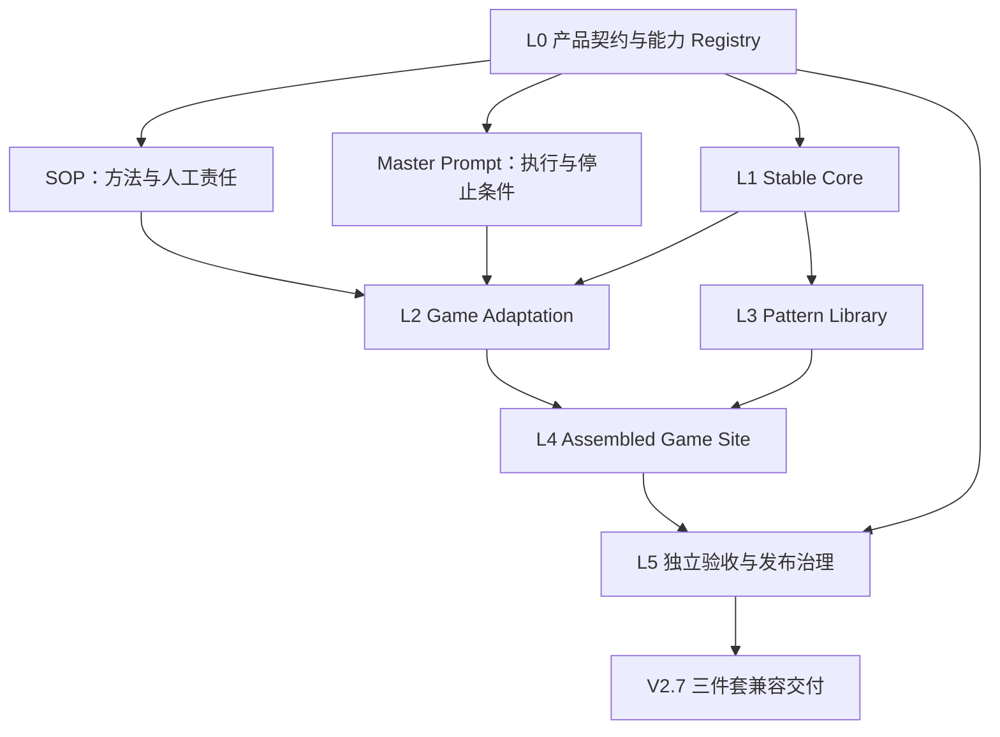
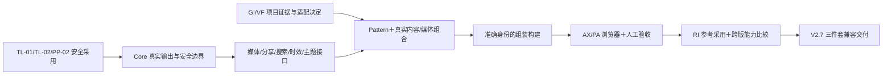

# V2.7 商业游戏站生产体系架构蓝图 V1

日期：2026-10-01。状态：DESIGN_ACCEPTED，见 [独立审查与路线设计计划](../codex/verifications/v2.7-design/blueprint-acceptance-and-roadmap-plan.md)。用户已授权蓝图与路线设计；本文不是功能实现、部署或发布授权。

目标产品：GAME_SOP V2.7 + GAME_SITE_STARTER V2.7 + GAME_CODEX_MASTER_PROMPT V2.7。版本决定见 [V2.7_VERSION_DECISION.md](../governance/V2.7_VERSION_DECISION.md)。本蓝图以审计后的证据重新推导；旧 V1 蓝图/路线保留为历史提案。

WS-01 文字澄清（2026-10-01）：依据 [实际独立 PLAN](../codex/prompts/v2.7-ws01/prompt.md)，确定性 Reference Regression 与真实项目采用使用不同命名空间。原 DESIGN_ACCEPTED 记录保持历史身份；本次有限澄清随 WS-01 独立审查，不改变六层架构、能力 ID 或逻辑依赖。

## 1. 设计输入与证据边界

| 输入 | 用于设计的结论 | 不可据此声明 |
| --- | --- | --- |
| [三件套权威盘点](../audit/TRIAD_AUTHORITY_INVENTORY_V1.md) | SOP 管方法；Prompt 管执行；Starter 管可复用技术 | 三件套可以互相重定义职责 |
| [真实项目/参考能力 crosswalk](../audit/REAL_PROJECT_AND_REFERENCE_EVIDENCE_CROSSWALK_V1.md) | 每个增量须对应观察问题或参考模式 | 研究观察等于最终产品验收 |
| [War of Genesis 验收](../../../gameweb/game_warofgenesis/docs/PRELAUNCH_ACCEPTANCE_2026-09-15.md) | 构建通过仍可能法律残留、Escape 缺失、游戏识别弱、标题大于正文、OG 不足 | 旧项目已完成 V2.7 采用或复验 |
| [Bomb Farm 媒体缺口](../../../gameweb/game_bombfarm_v2/docs/VISUAL_MEDIA_GAP_REPORT.md)、[V2.1 增补](../../../gameweb/game_bombfarm_v2/docs/V2_1_VISUAL_MEDIA_ENRICHMENT_REPORT.md) | 有效技术结构仍需媒体需求、真实游戏 UI、视觉适配、文章节奏；项目层补强可提炼 | 22 个资产/23 个文件等于人工审核 PASS |
| [Bomb Farm 广告诊断](../../../gameweb/game_bombfarm_v2/docs/ADS_MONETIZATION_REPAIR_REPORT.md) | placement、预留空间、provider 交付分别诊断 | 自动化环境 403 证明根因、真实填充或收入 |
| [四个原站观察](../LIVE_SITE_VALIDATION_2026-10-01.md)、[截图登记](../case-evidence/SCREENSHOT_REGISTRY.json) | 提炼玩家路径、任务文章、媒体组合、学习路径 | 五个原站均验证，或五站商业成功 |
| [五份本地实现审计](../5_SITE_PATTERN_CAPABILITY_AUDIT.md) | 组件/组合/主题设计输入；参考实现自身也有缺陷 | 装饰图是实际游戏证据；本地测试已运行 |
| Farever | 仅本地幻想主题与字体模式候选；原站 UNVERIFIED | 站内数据未取得，不能下市场判断 |
| [产品契约 v0.2](../COMMERCIAL_GAME_SITE_PRODUCT_CONTRACT_V0.2.md) | 41 个能力 ID、适用性、严重度、owner 和生命周期的设计来源/前代快照 | 蓝图可以静默改 ID、改语义或提升 PASS；它不是最终 V2.7 交付权威 |

冻结本地比较基线：SOP `9a13b7314b9cb102b0c440d9677ab22400109e8f`；Prompt `f655a0e08529060be8b716330ffcecf489a4484d`；Starter `29b25559cf2af859bca359c7f7fda686a4803c95`。这是本地来源身份，不替代各自 release tag。

现有 Starter Candidate 保留：S1/TL-01 `a691661b330896f81f28fcac855f0ef9cc1dfccb` → A1/TL-02 `a3c1bd31d87321ae40c44933fad8f8649e7f017d` → A2/PP-02 `aad6464b6be1584297866518e2ac036fbd0bd1a4` → A3/AX-01 `b067e8d4050478072f25a1dc78a8526cdd128cfd`。A3 仅 IMPLEMENTATION ACCEPTED；浏览器 NOT PROVEN。AX-03 未完成、未证明；A4 保持暂停。历史 653 测试 PASS 不是本轮新实测。

## 2. 三种方案与取舍

| 比较标准 | A：扩大通用 Starter | B：三件套每改必同步 | C：按能力职责协同演进 |
| --- | --- | --- | --- |
| 真实问题解释力 | 能修技术；人工/媒体责任仍在代码外 | 强调流程一致，但可能重复错误约定 | 将实现、方法与独立验收逐项映射 |
| 权威清晰度 | 容易让配置代替方法/事实决定 | 同一要求三处重复，冲突难裁决 | SOP 方法、Prompt 执行、Starter 技术各自权威 |
| 跨游戏复用/过拟合 | 常把游戏分类与视觉塞进 Core | 技术可复用，方法变更耦合过强 | Core 稳定，游戏数据/主题留适配层 |
| 维护成本 | 初期集中；后期条件分支多 | 每个小补丁三处维护 | 需影响分类；纯内部修复可单层进行 |
| 实现复杂度 | 短期可直接增组件 | 代码复杂度低，文档协调复杂 | 初期需要契约与回归；不需新服务 |
| 回归隔离 | 广泛技术改动影响全站 | 文档同步本身不证明组合行为 | Core、组合、参考采用、跨版四层验证 |
| 商业站适用性 | 支撑界面，难覆盖内容价值/权利/人工审核 | 易把完成清单当商业结论 | 面向玩家任务、游戏识别、媒体、布局与人工门槛 |
| 真实采用成本 | 起步快，项目补丁多 | 小调整也需解释三处一致性 | 需先作采用决定；长期减少绕过与重复补丁 |
| 版本/来源 | 单代码版本清楚，三件套组合易漂移 | 版本号一致不保证内容一致 | 精确来源＋兼容清单绑定三个工件 |

选择 C。A 适合单一短期项目，B 适合每次变化都跨方法边界的少量规范；本项目既有纯技术补丁，也有媒体权利、人工审核与真实采用问题，按责任分类的方案更符合证据。代价是先维护契约和回归映射；通过文档与现有静态代码即可实现，不引入 CMS、DAM、插件平台或策略服务。

## 3. 六层架构与三件套权威

箭头是依赖/约束，不表示开发阶段。L2 的配置选择 L3 的组合，二者共同组装 L4；L3 不依赖某款游戏实现。L5 可将失败反馈到对应 owner。

| 层 | 拥有的责任与输入/输出 | 禁止越界 |
| --- | --- | --- |
| L0 产品契约/Registry | 由 GAME_SOP V2.7 持有规范，管理 41 ID 的含义、适用性、严重度与生命周期；输出逐版本能力证据要求 | 不成为新路由数据库、运行时规则引擎或第四个产品 |
| L1 Stable Core | 读取已批准 Inventory/配置/媒体；提供启用解析、静态生成、SEO、搜索/媒体/广告接口、安全默认、可访问交互和产物审计 | 不选游戏分类、页面覆盖、事实、主题、媒体权利或人工批准 |
| L2 Game Adaptation | 项目拥有术语/分类、视觉依据、主题角色值、媒体映射、页面组合选择、关系、更新依据、条件能力选择 | 不复制路由/发布真相，不绕过 Core final 门槛 |
| L3 Pattern Library | 可复用 Astro/MDX 页面组合、文章模块与媒体/广告位置意图；消费 Core 解析结果和适配数据 | 不重写路由、SEO、媒体验证、法律/身份安全或导航控制 |
| L4 Assembled Game Site | 一个真实游戏的内容、事实、资产、配置与最终静态输出；保留采用来源 | 不把项目事实或 provider 凭据回灌通用 Starter |
| L5 独立验收/发布治理 | 对准确构建做技术、玩家任务、视觉媒体、声明/政策、广告、版本回归审查；输出验收与兼容记录 | 不用 Core 单测或旧 PASS 替代当前项目人工决定 |

SOP 跨层定义研究、覆盖、适配、媒体选型、人工审核、发布维护方法；Master Prompt 引用并强制执行这些方法以及 Starter 提供的真实命令；Starter 交付 L1 与 L3 的技术能力、适配接口及开发文档。Pattern 技术代码初期随 Starter 维护，保持逻辑边界；不新建五套 Starter。

L0 是逻辑规范层，归属 **GAME_SOP V2.7**，不增加第四个规范工件。最终单一规范文件约定为 `GAME_SOP/docs/COMMERCIAL_GAME_SITE_PRODUCT_CONTRACT_V2.7.md`（相对最终交付 root；当前尚未创建）。该文件同时持有 Product Contract 和 Capability Registry：ID、规范语义、适用性、严重度、owner、证据要求、生命周期与 replacement/deprecation 历史只在此维护。Prompt 引用并执行，Starter 实现其负责的技术子集；两者均不得维护另一个可编辑 Registry。

当前 `template/COMMERCIAL_GAME_SITE_PRODUCT_CONTRACT_V0.2.md` 保留为设计来源/前代快照，不静默覆盖。SOP V2.7 规范文件经独立接受并由包清单纳入后，才承接最终规范权威；现在没有提前创建 SOP 产品。能力结果快照和测试覆盖映射是准确版本的证据，不是另一个规范源。

## 4. 契约边界与数据真相

以下是设计契约，新增字段和接口尚未实现；具体 schema/API 在各实施切片中确定。已有路径已核对，不把拟议接口冒充现有命令。

| 边界 | 必需契约与失败处理 |
| --- | --- |
| Core ↔ Adaptation | 项目通过 Page ID 引用已批准页面；Core 唯一解析 route、enabled、indexable。未知/禁用引用失败或按现有诚实 unavailable 规则显示；适配记录不得新增 route/publish 状态 |
| Core ↔ Pattern | 组合只消费 resolved pages、受验证媒体、Core SEO/导航/搜索/广告组件；禁止自行拼另一套 canonical、媒体 URL 或发布过滤。无内容的模块不制造占位交互 |
| Pattern ↔ Adaptation | 组合声明所需模块、媒体需求与可接受无媒体版本；项目选择页面组合和提供内容。必需媒体缺失不得静默换装饰图；人工批准的重分类/waiver 经原 lifecycle 验证 |
| Assembled Site ↔ Acceptance | 交付准确 source commit/tree 或文件哈希、配置/Inventory/资产哈希、build mode、命令、浏览器与视口、时间、检查范围、reviewer；缺项记录 NOT RUN/PENDING/BLOCK，不写 PASS |
| SOP ↔ Prompt | SOP 定义何时做、由谁决定、接受什么证据；Prompt 引用相应条款并执行停止条件，不重定义来源、权利、waiver、内容价值或发布责任 |
| Starter ↔ SOP/Prompt | Starter 暴露真实验证命令、schema 限制与结果；SOP/Prompt 同步采用说明。配置合法性不能证明事实、主体真实性、政策准确性或游戏识别 |

保留的数据权威：`src/data/page-inventory.json` 管页面身份与发布；`game.config.ts` 管站点/功能与导航选择；`src/content/` 管正文；`src/data/facts/` 管结构化事实；`src/data/media/media.json` 管资产与映射；`src/config/ads.ts` 管可选广告决策与 semantic placement；主题角色延展自 `src/styles/theme.css`。媒体 lifecycle 的方法权威继续属于 SOP 决策表，现有 `src/core/media-readiness.ts` 保持确定性投影，不把它提升为权利审批器。

适配记录的最小信息：来源三件套、术语/分类来源、视觉证据→主题角色的对应、Page ID→组合选择、媒体/视频需求决定、搜索启用理由、内容关系与更新依据。记录事实来源与设计解释的区别；它引用现有数据权威，不复制成一份大型配置。

媒体增量：在现有 local image/local MP4/WebM/YouTube 模型上定义尺寸/比例、语义类别、credit/rights 证据引用、信息型 alt/caption、视频字幕或等价说明及失败 fallback；分享媒体复用同一 asset ID。布局元数据不是权利证明，声明字段不能自动批准。保留现有本地路径/host 验证；provider-neutral 表示统一接口与既有 adapter 隔离，不开放任意 iframe/远程资源。

搜索增量：中立查询/结果/状态边界，继续使用现有 Pagefind adapter、安全 URL/摘要与产物预算。项目必须记录启用/关闭理由；不新增搜索服务。广告仍 disabled-by-default；Pattern 决定位置意图，项目 provider edge 决定交付；关闭时零输出，空槽与填充分别验证，不自动接网络或统计服务。

内容时效：保留 publishedAt、updatedAt 与验证/patch 依据的区别；静态推荐称编辑推荐，未证实 Popular/Live 不展示。可用内容不足时减少模块或采用诚实无数据状态，不为了深度重复卡片。标题不满足玩家任务时改正文或收窄标题，不补造数值。

## 5. 五案例如何成为可组合能力

| 参考 | 提炼方向 | 纳入位置/能力 | 不继承的问题与证据限制 |
| --- | --- | --- | --- |
| VV ULTIMATUM | Start Here、实体 hub→比较/详情→下一步、诚实 unavailable | Pattern 的 wiki/hub 组合；项目分类；HR-01/02、IA-01/02、DS-01/02 | 静态 Trending 不作热门证明；本地 CSS art 不补媒体证据 |
| Farever | 展示/正文/辅助字体层次、沉浸式色彩/形状组合 | Adaptation 的主题候选；VF-01/02、GI-02 | 原站 UNVERIFIED；不冻结“幻想主题”成 Core 或必交付 Pattern；重复目标卡片不扩充覆盖 |
| Gamble With Your Friends | Quick Answer、步骤、错误修复、比较表、figure、next action | task-guide Pattern 与 MDX 模块；CU-01/02、DS-01/02、MC-03 | 不继承 publishedAt 显示为 Updated、任意 related 或合成图当截图 |
| Mini Wars | 任务/难度阅读路径、实体关系、显式/标签相关性、战术语义角色 | hub/related 组合与适配；ID-01/02、IA-01、VF-01、AX-01 | 不继承假 live/online；本地已有导航测试不证明候选浏览器行为 |
| Bomb Farm 原站/本地参考 | cover＋TOC＋正文媒体＋FAQ＋related，浏览与文章节奏 | media-rich article 组合；CU-02、MC-01/03/04/05、MR-02 | 不继承重复封面、广告占位、实现命令泄露；原站 TOC 滚动待复测 |

最小模式库按玩家用途形成 hub/wiki、task-guide、media-rich article 三类组合和共享模块，主题由项目提供。五个参考是取材来源，不自动产生五种完整主题产品。每个组合须声明适用任务、必需内容/媒体、无媒体方案、可选模块及验证范围；图表/比较/FAQ 有事实依据才启用。

## 6. 能力、owner 与三件套同步

Requirement owner 继承现有契约（RI-04 为 Capability Registry，其余为 Product Contract），二者在最终产品中同属 SOP 的单一规范文件，不由实施层重定义。表中“实现层”细分实际承接；验证由独立 Acceptance 执行/接受，注明必须由人完成的项。同步分类继承 [演进决定](../governance/TRIAD_EVOLUTION_DECISION_V1.md)，区分机制与方法；保留行不表示已完成整个项目级能力。

| 依据/范围 | 能力 ID | 实现层 | SOP 方法责任 | Prompt 执行责任 | 验证 owner / 证据 | 同步 |
| --- | --- | --- | --- | --- | --- | --- |
| 法律残留/声明准确 | TL-01、TL-03、PP-02 | Core 安全＋项目真实政策 | 激活/行为对照/人工责任 | 草稿及未支持 final 停止 | Acceptance＋人工政策审核，source/output/行为对应 | ALL_THREE；TL-03 准确性方法为 SOP + PROMPT |
| 隐式主体/关联声明 | TL-02 | Core 既有显式身份＋适配来源 | 可声明角色与证据 | claim/source gate | Acceptance＋人工主体证据；公开署名/结构化输出 | ALL_THREE |
| Escape/focus/断点 | AX-01、AX-02、AX-03 | Core 交互＋组合浏览器验证 | 支持矩阵、人工 focus/对比度 | 实际执行，缺项不 PASS | Acceptance，真实浏览器与视觉检查 | ALL_THREE |
| 游戏识别/主题角色 | GI-01、GI-02、VF-01、VF-02 | Core semantic roles＋项目术语/主题 | 官方视觉证据与去品牌识别审核 | 执行已批准适配，不靠换色完成 | Human Product Review＋Acceptance | ALL_THREE |
| 媒体/视频/分享 | MC-01、MC-02、MC-03、MC-04、MC-05、SEO-02 | Core schema/render＋适配决策＋Pattern 位置 | need/rights/人工/no-media 生命周期 | 遵守批准/阻塞与 final/evidence | Acceptance＋人工语义/权利/视觉，schema/产物/播放 | ALL_THREE |
| 搜索选择 | IA-03 | Core neutral seam＋Pagefind＋项目选择 | 语料与用途理由 | 核验选择，启用才检查 UI | Acceptance，adapter/预算/查询状态 | ALL_THREE |
| 玩家路径与分类 | HR-01、HR-02、IA-01、ID-01、ID-02、DS-02 | Pattern＋适配分类/关系；Core 过滤 | 有用起点/目标/恢复路径 | 禁止假链接与重复目标充数 | Acceptance＋Human Content Review | ALL_THREE；ID-02 仍 OPTIONAL |
| 标题承诺/比较依据 | CU-01、DS-01 | 项目事实与正文 | 答案、方法、适用版本/范围 | Human Content Gate，不虚构 | Human Content Review，玩家任务与来源 | SOP + PROMPT |
| 文章结构与真实深度 | CU-02、MR-02 | Pattern 模块＋项目内容 | 按复杂度选结构与真实目标 | 内容与组合验收 | Human Product Review＋Acceptance | ALL_THREE（含通用模块增量） |
| 日期/动态语义 | FR-01、FR-02 | Core 字段/渲染＋项目依据 | 发布/更新/验证区别与来源 | 拒绝无依据热门/实时声明 | Acceptance＋内容审核，字段/可见标签对应 | ALL_THREE；声明治理为 SOP + PROMPT |
| 可选广告 | MR-01 | Core 既有 seam＋Pattern 位置＋项目 provider | 位置/遮挡/真实交付分开 | 条件启用、人审与缺项说明 | Acceptance＋Human Ads Review，布局/CLS/遮挡 | ALL_THREE（位置/采用增量）；保留 provider 隔离 |
| 既有出版/SEO/恢复 | IA-02、SEO-01、SEO-03、PP-01 | Core＋项目提供有效值 | 保留现有方法 | 继续执行既有审计 | Acceptance，准确路由、禁用过滤、生成产物 | NO_CHANGE；持续回归 |
| 组合独立验收/例外 | PA-01、PA-02 | 项目验收记录＋发布治理 | 人工责任、允许的 P2/NIT 例外 | 当前构建证据、拒绝继承旧 PASS | 独立 Acceptance/Release Gate | ALL_THREE（证据 hooks）；例外方法为 SOP + PROMPT |
| 模式不复制 Core | RI-01 | Starter 的 Core/Pattern 边界 | 改动责任分类 | 阻止项目级绕过 | Architecture/Acceptance review＋组合测试 | ALL_THREE |
| 参考/跨版/生命周期 | RI-02、RI-03、RI-04 | 回归 fixtures 与版本证据 | 参考采用、生命周期/迁移规则 | 能力 delta、准确来源/兼容 Gate | 独立 Release Gate | ALL_THREE |

此表完整覆盖 41 个既有 ID；不新增或改变 capability 含义、严重度、适用性。分组里的同步细分是不同机制/方法增量，逐切片须选一个准确分类；纯内部 CSS/实现修复不涉及方法时仍可 STARTER_ONLY。任何未来真正的新 requirement 必须单独提出语义和 ID 决策，不能在蓝图中静默注册。

## 7. 既有能力保全与逻辑依赖

保留 Inventory SSOT、enabled catalog、准确 reconciliation、canonical/robots/sitemap/可见内容匹配 JSON-LD、Pagefind 安全与 800,000 B 完整规范产物预算、现有媒体校验与确定性 readiness 投影、显式 related、广告关闭零输出和 provider 隔离、final/evidence marker 隔离、S1/A1/A2 安全增量、A3 原生 details/summary 交互实现。不得以“架构升级”悄悄放宽检查或另建绕过脚本。

逻辑依赖：

安全默认已经实现的部分复用，不重新执行 A1/A2。浏览器验证既保护 Core 交互，也必须覆盖后续组合；这是一项持续依赖，不意味重新开 A4 或提前决定路线顺序。

## 8. 四层回归与证据模型

| 层 | 保护什么 | 证据要求 |
| --- | --- | --- |
| Core Regression | 路由/禁用、SEO/媒体/搜索、安全默认、residue、广告、原生交互 | 既有 meaningful unit/产物测试；正/负采用 fixture；准确 source、命令、退出码 |
| Composition Regression | 组合不复制 Core；媒体有/无、搜索开/关、广告开/关、长表/TOC/FAQ/关系 | 真实生成输出、浏览器可达性/键盘/overflow、禁用泄漏/必需媒体缺失失败 |
| Reference Archetype / Real Adoption Regression | RI-02 的确定性 REF-A/B/C suite 与独立真实采用，两组证据均保留 | REF-A＝Wiki / Commercial Editorial、REF-B＝Problem Guide / Tool、REF-C＝Tactical / Systems，原契约 §V 的内容/媒体/验收义务全部保留；PROJECT-WOG、PROJECT-BOMBFARM、PROJECT-TASK-GUIDE 是额外真实采用。多对多 coverage 不能替代任一 REF suite PASS；项目内容/媒体人工决定仍需实际审核 |
| Cross-Version Regression | RI-03/04：仍有效能力不能静默消失 | 41 ID 逐项比 frozen V2.6.5、accepted A3、V2.7 候选；旧证据区分 portable/项目/未证明；明确生命周期变化和迁移 |

Evidence record 至少绑定 capability ID、适用条件、source/build 身份与资产/配置哈希、build mode、检查类型、范围/环境/时间、可读取证据、reviewer、结果/限制。Registry 的 ACTIVE 等是生命周期；工作流 evidenceStatus 为 NOT_RUN/PENDING/OBSERVED/UNVERIFIED，与前代 §W 的最终 outcome 分开。verifiedOutcome 只能为 PASS/FAIL/NOT_APPLICABLE/NOT_SELECTED/批准的 EXCEPTION，或在尚未裁定时为 null；非 OBSERVED 状态必须是 null，不满足发布 Gate。旧报告更新不得抹去后来 BLOCK；新变更影响结论时重新审核。

验收包含：首页/各启用家族代表、disabled/unknown/404、长文章、媒体与交互状态；覆盖承诺的浏览器/断点、Tab/Shift+Tab/Enter/Space/Escape/focus、899/900/901 当前导航边界、reduced-motion/no-JS、可见焦点/对比度。完整支持矩阵与命令须在实施计划固定；未执行不记 PASS。

公开能力通过需要其适用证据；无法获得的原站观察保持未验证。P0/P1 阻塞和仍有效的既有能力回归阻塞交付；仅允许契约规定的 P2/NIT 例外，需 owner、理由、证据、范围、严重度、到期/复审日期。SOP 原合法媒体 waiver 组合继续保留，不由自动代码判断实质正当性，也不等于任意 release waiver。

## 9. 开发来源、兼容组合与交付

沿用当前 Starter Candidate 的准确 Git 历史，设计阶段不迁移/复制。SOP/Prompt 后续采用各自 V2.6.5 基线的独立候选，路线明确拟议位置与建立时点；冻结目录不覆盖。三件套通过准确 source commit/tree 或文件哈希形成兼容组合，而不是只看 V2.7 文件名。

最终 root 为 `Repo_hotgameweb/GAME_SITE_SYSTEM_V2.7/`；结构与 [DELIVERY_LAYOUT.md](../DELIVERY_LAYOUT.md) 一致，含三个工件、COMPATIBILITY_MANIFEST.json 和入口 README。这是验证后的 assembly/delivery root，不是第四个开发源码权威。清单绑定三件套版本、来源、准确身份、契约版本/哈希、已接受蓝图与路线、能力 delta、参考采用/独立验收、例外及兼容范围。

兼容清单中的 L0 绑定必须包含 `productContractVersion`、`capabilityRegistryVersion`、`canonicalPath`、`sha256`、`owningArtifact = GAME_SOP`；`canonicalPath` 固定指向上述 SOP 包内单一规范文件，并与 SOP 的准确 commit/tree/hash 和 PACKAGE_MANIFEST 条目对应。Prompt/Starter 引用相同契约身份；不带未版本化研究目录才能解释能力的隐藏依赖。

交付整理时按清理清单判断 18 份历史文档是否继续有效/归档/被替代，现在不搬。交付导出排除依赖安装、dist/cache、秘密环境值、临时日志、未完成任务。`package.json` 的继承应用版本不自动充当 Starter 产品版本。上线、tag、push、merge、release 需要相应实际工作和授权，设计通过不代表完成。

## 10. 蓝图验收与下一设计动作

独立审查须确认：三件套职责与单一数据权威；三方案真实取舍；每项设计可追溯；Farever 与原站/本地/采用证据分层；41 ID 无静默变更；S1/A1/A2/A3 保留且 AX 未冒充证明；Core/Adaptation/Pattern/Acceptance 边界与契约明确；方法/执行/技术 owner 不互吞；逻辑依赖不变成实现授权；RI-01~04/PA-01 与四层回归可用；兼容交付 root 语义一致。

本次没有提出新 capability。蓝图审查 ACCEPT 后，才从本文依赖关系制定 V2.7 演进路线，明确 workstream、三件套变化、前置、证据、验收/回归和真实采用义务。设计阶段不改 Candidate、冻结三件套、真实项目或五份参考源码，不恢复 A4。
