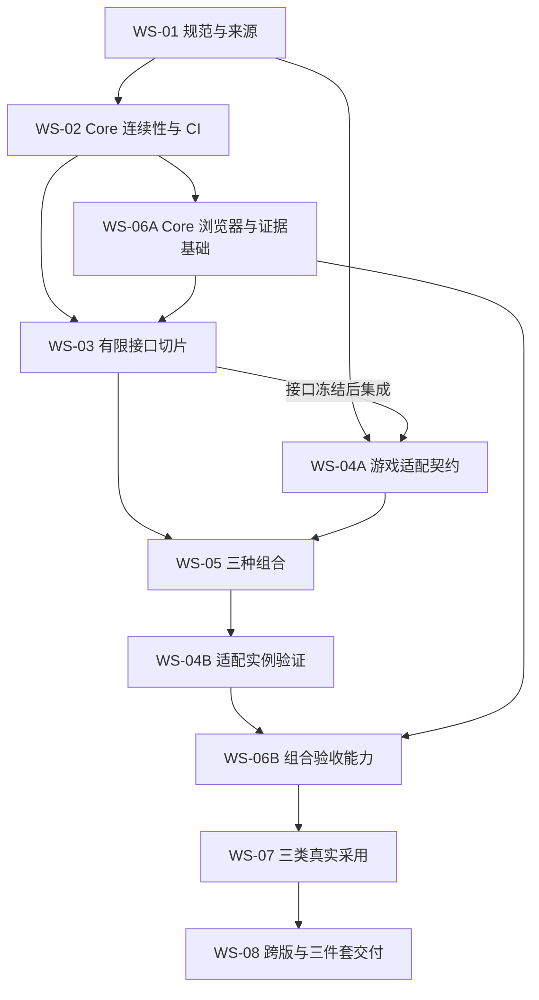
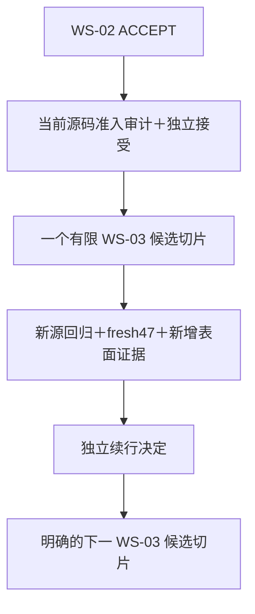
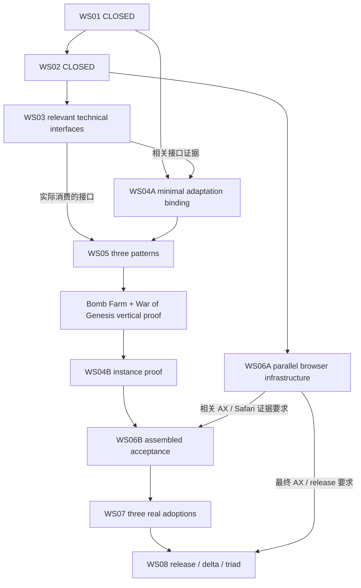

# V2.7 商业游戏站生产体系演进路线 V1

> **2026-10-08 当前执行权威：** 用户已批准采用 [Simplification Amendment V1](../architecture/V2.7_ARCHITECTURE_SIMPLIFICATION_AMENDMENT_V1.md)。本路线 §1–6（含 §3.1）与原 DAG 保留为历史接受设计；未来执行的依赖与证据节奏按新增 [§7 current interpretation](#7-2026-10-08-simplification-amendment--current-interpretation)。本轮只做治理整合/iteration35 归档，完成后 STOP，等待独立 Review；唯一下一步为 `consolidated WS03 TECH Review`，本轮不执行它或开始产品编码。

日期：2026-10-01。状态：DESIGN_ACCEPTED，见 [独立验收](../codex/verifications/v2.7-design/roadmap-acceptance.md)。依据：[已独立 ACCEPT 的 V2.7 蓝图](../architecture/GAME_SITE_SYSTEM_V2.7_ARCHITECTURE_BLUEPRINT_V1.md)及 [独立审查/设计 PLAN](../codex/verifications/v2.7-design/blueprint-acceptance-and-roadmap-plan.md)。这是设计路线，所有 workstream 的实施均未开始，不恢复旧 A4。

以上为设计接受时的历史状态。用户随后授权按路线推进；WS-01 依 [实际独立 PLAN](../codex/prompts/v2.7-ws01/prompt.md)执行有限规范基础工作。本次仅澄清 REF-A/B/C 确定性 fixture 与 PROJECT-* 真实采用的双命名空间、证据状态与 outcome；不改变八个 workstream、DAG、41 ID 或规范语义。澄清随 WS-01 复验。

## 1. 路线目标与排序依据

产出协同工作的 GAME_SOP V2.7、GAME_CODEX_MASTER_PROMPT V2.7、GAME_SITE_STARTER V2.7，经真实采用和独立验收后组装至 `Repo_hotgameweb/GAME_SITE_SYSTEM_V2.7/`。商业适用性通过玩家任务、识别、真实内容/媒体、可用性和商业布局验收；不将技术通过当成流量、收入或市场成功证明。

先统一规范与来源，再保护现有 Core；通过有限切片补齐接口，形成明确的项目适配和三种组合；浏览器基础尽早建立，完整验收必须针对组合后页面；三类真实采用及逐能力跨版本比较通过后才导出交付包。旧 A1/A2/A3 不重新实施，旧 Phase A 顺序不是本路线来源。

八个 workstream 是组织任务的编号，不是新增 capability ID。41 个规范 ID 和原适用性/严重度保留，唯一语义源将随 SOP V2.7 交付；工作流、测试覆盖和 delta 只引用它。

## 2. 开发来源与候选策略（拟议，尚未执行）

| 工件 | 准确来源 | 拟议开发位置/建立时点 | 约束 |
| --- | --- | --- | --- |
| SOP | `Repo_hotgameweb/GAME_SOP_V2.6.5`，`9a13b7314b9cb102b0c440d9677ab22400109e8f` | WS-01 建立独立 `Repo_hotgameweb/GAME_SOP_V2.7_CANDIDATE/` | 保留 Git 来源与历史，冻结原目录；新规范纳入 PACKAGE_MANIFEST |
| Master Prompt | `Repo_hotgameweb/GAME_CODEX_MASTER_PROMPT_V2.6.5`，`f655a0e08529060be8b716330ffcecf489a4484d` | WS-01 建立独立 `Repo_hotgameweb/GAME_CODEX_MASTER_PROMPT_V2.7_CANDIDATE/` | 保留 Git 来源与历史；只引用 SOP 规范身份，不复制 Registry |
| Starter | 现有 `Repo_hotgameweb/GAME_SITE_STARTER_PHASE1_CORE_SAFETY_CANDIDATE`，`b067e8d4050478072f25a1dc78a8526cdd128cfd` | WS-02 在同一仓库从 accepted A3 建立拟议 `v2.7/evolution` 开发分支 | 不复制/搬移仓库；保留 `phase-a/core-safety` 历史与 S1/A1/A2/A3；分支尚未创建 |

Starter 三方案比较：继续现有分支最省操作，但新路线与历史 Phase A 状态混杂；新分支保留所有祖先、容易对照 accepted A3，且不产生第二份源码副本；新仓库可以保留历史，但增加路径/权威迁移和清理负担。选择同仓库新分支。建立前重新核对 CLEAN/HEAD；遇到已有同名候选/分支先核对来源，不覆盖用户改动。SOP/Prompt 独立候选同样只从核对后的本地基线建立；具体本地创建命令在 WS-01 实施计划中验证，不联网拉取新基线。

SOP 内的拟议唯一规范路径为 `docs/COMMERCIAL_GAME_SITE_PRODUCT_CONTRACT_V2.7.md`，同时持有 Contract 与 Registry。WS-01 独立接受并纳入包清单后才承接 V2.7 规范权威。当前 `template/COMMERCIAL_GAME_SITE_PRODUCT_CONTRACT_V0.2.md` 保留原文/哈希作为前代输入。所有候选路径、分支、规范文件和最终交付目录目前均只是约定；本轮没有创建它们。

## 3. 依赖 DAG 与阶段门槛

下图是正式验收/发布 DAG。第20轮的有限开发入口见 §3.1；只在该治理修订独立接受后生效，不能替代图中的正式依赖。

正式硬前置：WS-02 依赖 WS-01；WS-06A 依赖 WS-02；WS-03 正式实施/退出路径依赖 WS-02/06A ACCEPT，有限候选开发另须满足 §3.1；WS-04A 可以在 WS-01 后设计方法模板，但契约 Gate 依赖 WS-03 接口接受；WS-05 每种组合依赖其 WS-03/04A 输入接受；WS-04B 在 WS-05 后完成实例验证；WS-06B 依赖 04B、组合与 06A；WS-07 完整采用验收依赖 06B；WS-08 依赖全部前置接受。

可并行的是设计/研究或输入已接受后的有限切片，不是绕过 Gate：WS-04 的术语/主题证据模板可与 06A/03 设计并行；WS-03 已冻结接口对应的 WS-04 集成、WS-05 模块可先准备，但 workstream 退出必须等待其完整前置。WS-07 第一手事实/媒体权利准备可提前，完整结果必须绑定最终接受的组合和准确构建。

所有 Gate 要求：受影响 capability 与三件套增量明确；meaningful 技术/产物证据通过；该阶段适用浏览器/人工证据齐全；既有能力无未授权回归；独立 ACCEPT；下一阶段输入准确冻结。计划中的 PASS 不是已执行的 PASS。步骤不得以“先实现后补 SOP/Prompt”退出。

### 3.1 有限开发准入与正式验收分离 — 第20轮治理修订

依据[实际 PLAN20](../codex/prompts/v2.7-ws06a/iteration20-development-readiness-governance-amendment-plan.md)实施；仅在[本轮独立审查/结果](../codex/executions/v2.7-ws06a/iteration20/result.md)实际 ACCEPT 后成为有效治理。第19轮提案和历史证据保留原字节。该修订不增加主任务、capability、生产 schema 或 checker；八个 workstream 和41规范 ID 不变。

`WS06A_DEVELOPMENT_READINESS` 是治理流程状态，取值 NOT_EVALUATED、BLOCKED、ACCEPTED_FOR_BOUNDED_DEVELOPMENT、STALE；不是 Contract/Registry 字段、§W verifiedOutcome、PASS、EXCEPTION、NOT_APPLICABLE、NOT_SELECTED 或 WAIVED。修订接受只激活流程，当前源码的 readiness 仍为 NOT_EVALUATED，WS-06A BLOCKED、Safari proof0、WS-03代码未开始，主任务关闭数仍2/8。

先独立接受治理修订，再审计当前源并独立签署准入，才可执行一个有限候选计划。建议03A→03B→03C→03D-search→03D-freshness；03C仍须03B实际接口独立接受，03D两部分分别计划/验证。首阶段仅WS-03、一片一次；不能自动解锁WS-03正式Gate、04A契约/集成、05、04B、06B实施/验收、07、08或release。

准入要求完整未改47矩阵、0 skip/NOT_RUN/漏测、非WebKit全部PASS、无未知基础设施错误。历史初始比较输入为10个WebKit失败病例/40断言（37 ENVIRONMENT_PROFILE_BLOCKED、3 PRODUCT_EVIDENCE_UNRESOLVED），见[冻结定位证据](../codex/executions/v2.7-ws06a/iteration19/residual-set-v1.json)。它不是永久产品要求或PASS白名单；当时失败须属于独立接受的准确集合、原detail/控制仍符合有效policy，后续只能减少为其子集。新增位置/断言失败即STOP，数量降低也不能隐藏新失败。每条当前残留必须有同category/role/route/viewport/JS/motion/assertion的当前Chromium及Firefox PASS；cross-engine corroboration不是Safari证明、WebKit等价或多数票PASS。raw FAIL与命令非零退出如实保留，严格browser/CI/closure入口不改。

绑定三件套身份、Starter branch/HEAD/working-tree manifest、Contract/matrix/runner/closure/policy/control/raw/native/独立expected SHA、fixture source/dist、Playwright及三个engine版本/revision、host/platform/arch、采集/审核日期、reviewer、期限/复查触发和下一切片。相关源、配置、构建、验证身份或工具/host变化即STALE；旧签署不能连续授权全部切片。每片按[SOP方法](../../Repo_hotgameweb/GAME_SOP_V2.7_CANDIDATE/docs/NEW_GAME_SITE_SOP_v2.7.md#bounded-development-readiness)做正负例、定向检查、root check、默认final拒绝、adopted validate/check/build、fresh未改47、额外新功能浏览器证据、残留/对应核对、正常清理与独立续行。基础47不证明新表面，新表面失败不能加入旧集合；缺证据、未知失败、弱化断言、身份不符或清理失败均STOP。`IMPLEMENTATION_ACCEPTED_FOR_CONTINUATION`仅准许明确下一片，不关闭正式Gate或提升能力。

Safari缺证据且完整06A未接受期间，AX-01/02/03与PA-01不提升，human focus/contrast仍另需审查，WS-03正式Gate保持开放，06B/07/08及组装发布保持阻塞；开发准入不授权commit/push/tag/merge/部署/发布。源稳定后：冻结准确构建→fresh47与新增表面→核对当前policy/control→允许通道上的真实Safari证据→实际verify:browser-closure→独立完整06A审查→逐片复验/重跑stale证据→独立恢复正式WS-03 Gate及原DAG。真实Safari FAIL须产品修复并重验，不能因已投入开发豁免P0/P1。严格47全PASS分支仍由原closure处理，商业发布的代表性真实Safari检查义务不删除。不得用其他工具绕过访问拒绝或伪造按键、focus、scroll、键盘偏好。

## 4. 八个 workstream

### WS-01 — 规范基础与采用证据约定

- **目标/能力**：将全部 41 ID 原语义带入 SOP 的单一规范源，落实 RI-04、RI-03 的 baseline 和 PA-01/02 证据/例外方法。
- **依据**：[权威盘点](../audit/TRIAD_AUTHORITY_INVENTORY_V1.md)、[同步决定](../governance/TRIAD_EVOLUTION_DECISION_V1.md)、蓝图 L0 修订；真实报告 PASS/BLOCK 时间冲突。
- **工件/主 owner**：SOP 持规范/方法；Prompt 引用准确身份、停止条件和采用阶段；Starter 此阶段仅定义将引用什么，不改源码。
- **前置**：蓝图和路线独立 ACCEPT，以及本阶段实施计划获得执行授权。
- **实施边界/排除**：建立 SOP/Prompt 独立候选，迁入规范与 adoption/证据方法；不改 frozen、Starter、真实项目、41 ID 语义或新技术能力。
- **测试/证据**：逐行比较 41 ID、要求/适用性/严重度/lifecycle/owner；包 manifest 路径齐全；单一 canonical 文件；引用身份一致；frozen 哈希保持。
- **独立 Gate/退出**：41/41 保留、0 静默语义变化、SOP 包内规范接受、Prompt 引用及停止条件正确、前代保留、准确候选来源记录，独立 ACCEPT。
- **回归/真实采用义务**：逐能力建立 V2.6.5 与 accepted A3 证据 baseline，不从历史测试数量推断全能力 PASS；方法模板必须能记录 War of Genesis/Bomb Farm 的 BLOCK/PENDING 与人工决定，完成采用证明仍在 WS-07。

### WS-02 — Stable Core 连续性与采用构建/CI

- **目标/能力**：复用 TL-01、TL-02、PP-02、AX-01 实现；保全 IA-02、SEO-01/03、PP-01、MR-01、IA-03 与 final/evidence。
- **依据**：accepted A3 历史与蓝图保全清单；[Candidate README](../../Repo_hotgameweb/GAME_SITE_STARTER_PHASE1_CORE_SAFETY_CANDIDATE/README.md)、当前 CI 在未采用例子上运行 final build 的冲突。
- **工件/主 owner**：Starter 开发分支、采用 fixture/CI/README；SOP 明确 example 不是 final-ready；Prompt 调用真实采用/验证命令并解释预期失败。主 owner 为 Starter，方法/执行同步为 ALL_THREE。
- **前置**：WS-01 ACCEPT。
- **实施边界/排除**：从 A3 建新开发分支；用现有 bounded adopted fixture 支持可重复 final 构建；修 CI 验证方式，不重新写 A1/A2、不装浏览器、不弱化 PP-02。
- **测试/证据**：未采用默认例子的 final 必须失败；采用后的中立 fixture `npm run validate`、`npm run check`、`npm run build` 必须通过；输出 reconciliation、SEO、Pagefind、广告关闭零输出和安全负例保留；CI 在准确候选验证同一路径。
- **独立 Gate/退出**：祖先 provenance 完整、采用构建与 CI 路径接受、预期失败被明确断言而不是忽略、0 final/evidence 绕过、已有能力无回归，独立 ACCEPT。AX-01 浏览器仍待 06A，不提前 PROVEN。
- **回归/真实采用义务**：验证项目不需用私有脚本绕过残留检查；War of Genesis 的法律/主体负例与 Bomb Farm 的 final/evidence 需求进入 fixture；真实声明审核不由这些例子代替。

### WS-03 — Core 接口补强，分四个有限切片

- **目标/能力**：VF-01/02、MC-01/03/05、SEO-02、IA-03、FR-01；扩展既有接口，不扩大页面范围。
- **依据**：蓝图契约、[V2.6.5 缺口审计](../GAME_SITE_STARTER_V2.6.5_CAPABILITY_GAP_AUDIT_V0.2.md)、War of Genesis OG/识别、Bomb Farm 媒体增补。
- **工件/主 owner**：Starter schema/adapter/render/审计；SOP 定义角色与媒体/搜索/时效选择；Prompt 同步命令、采用迁移和 HARD STOP。各切片按 ALL_THREE 或准确责任细分审查，不复制规范。
- **前置**：正式路径要求WS-02、WS-06A ACCEPT；有限候选开发可走§3.1的治理修订接受＋当前源独立准入路径。接口设计可提前；开发续行接受不作为04A/05正式集成输入。
- **有限切片**：03A 语义字体/密度/形状/状态角色；03B 资产尺寸/比例、rights/credit 引用、video accessible equivalent 与统一 adapter/fallback；03C 分享图以同一 media authority 解析与生成产物审计，依赖 03B；03D 搜索查询/结果状态边界＋现有 Pagefind、日期与 patch/验证语义。03D 的两部分独立提交/验证，避免耦合重构。
- **排除**：不加新 provider、CMS/DAM、远程资产平台、运行时统计；不改变路由/发布真相，不把字段合法性当权利批准。
- **测试/证据**：每切片 schema 正/负例、实际组件/输出、相关浏览器状态及继承回归；媒体有效/缺失/失败/无媒体、视频/等价说明、share fallback；搜索启用/关闭/无结果/错误、安全 URL/预算；published 不冒充 updated。
- **独立 Gate/退出**：四切片分别正式 ACCEPT；候选 IMPLEMENTATION_ACCEPTED_FOR_CONTINUATION 不关闭本Gate，须完整06A接受及逐片复验后恢复正式裁定。既有字段的兼容/迁移规则明确且经验证，legacy 无证据字段不能用默认值自动批准；required share/媒体缺失按契约阻塞；Core 无回归，三个工件要求/执行/实现一致。
- **回归/真实采用义务**：03A 支持 WoG/Bomb Farm 两种主题而不硬编码；03B/C 能承接 Bomb Farm 现有 local assets/video 与 WoG 的 share-media 缺口；03D 保留原 corpus 与 Pagefind 安全，项目启用选择在 WS-04/07验收。

### WS-04 — Game Adaptation 契约与采用流程

- **目标/能力**：GI-01/02、VF-01/02、IA-01/03、MC-02/04/05、FR-02、ID-01；让适配成为可核验决定。
- **依据**：真实项目泛化视觉/媒体/标题问题，五案例的不同分类与视觉语法；Farever 仅本地候选。
- **工件/主 owner**：SOP 的适配/视觉/内容/媒体模板、Prompt 的人工规划与实施核对、Starter 的受约束适配入口和可验证引用。游戏事实/选择的 primary owner 始终是项目。
- **前置/两段 Gate**：04A 在 WS-01/03 后接受方法模板与适配 schema/引用契约（含模式输入要求），供 WS-05 使用；04B 在 WS-05 三组合实现后验证实例组装并关闭 WS-04。04A 不以尚未实现的 Pattern 页面作为退出条件。
- **实施边界/排除**：记录来源三件套、术语/分类、视觉依据→角色、Page ID→模式、媒体/视频需求、搜索理由、关系、时效依据；不复制 Inventory routes/publication，不决定版权/主体真相。
- **测试/证据**：有效与未知/disabled Page ID、有效与不匹配模式/媒体需求、approved/no-media/PENDING/BLOCK lifecycle；主题证据与术语来源审查；模版实例不得藏无依据 Popular/Live。
- **独立 Gate/退出**：04A 的唯一数据权威、schema 正/负例与三件套方法/引用独立 ACCEPT；04B 无需私有 Core 绕过即可组装至少两种不同配置，每页需求/搜索/关系有决定，独立 ACCEPT。项目实际 GI-02/权利审批仍在 WS-07，不以通用模板宣告它们 PASS。
- **回归/真实采用义务**：预先准备 WoG、Bomb Farm 适配实例；无媒体必须是合理完整组合及合法人工状态，不能掩盖 unresolved rights；具体媒体数量不成为验收目标。

### WS-05 — 最小 Pattern Library 与内容价值组合

- **目标/能力**：HR-01/02、CU-01/02、DS-01/02、ID-01/02、MR-01/02、RI-01；形成 hub/wiki、task-guide、media-rich article 三类组合。
- **依据**：VV 的 hub/决策入口、Gamble 的问题文章、Mini Wars 的阅读关系、Bomb Farm 的 cover/TOC/媒体节奏。Farever 的本地主题层次只作适配选择，不承诺第四种产品。
- **工件/主 owner**：Starter 内 Pattern 组合/共享模块；SOP 的任务选型/标题承诺/真实深度；Prompt 的 approved composition 与 Human Content Gate。Primary owner 是 Pattern 技术实现和项目内容各自责任。
- **前置**：WS-03 各依赖接口与 WS-04A 适配契约接受；不依赖 WS-04B 实例 Gate。WS-05 完成后供 04B 实例验证使用，因此不存在循环前置。
- **实施边界/排除**：按三种组合分别交付；共享 Quick Answer、steps、mistakes/recovery、comparison、figure、TOC、FAQ、related/next action 按需使用；不搬入五站整套代码/游戏事实，不复制 Core 渲染安全/SEO/路由/导航。
- **必需/可选**：hub 必须起点与真实分类目标；task-guide 必须明确任务/答案与行动步骤或决策依据；media-rich article 必须语义相关的所需资产、正文和阅读导航。FAQ/比较/恢复/视频/广告依事实与任务决定；每种组合提供诚实完整的无媒体方案，使用它需记录重分类而不能冒充媒体已齐全。
- **测试/证据**：三套 composition fixtures 使用实际 Core；有/无媒体、搜索与广告开/关、TOC、长表、disabled/no-data；每种组合的实际输出/键盘/overflow；链接不能以重复目标凑深度；相关性手动→分类/标签→允许 fallback 的确定性验证。
- **独立 Gate/退出**：三组合分别 ACCEPT，required/optional 与 no-media 契约明确，RI-01 边界审查通过；内容模块不要求每页全用；原 Core 保全；人工内容方法同期接受。
- **回归/真实采用义务**：WoG 的标题/比较必须有答案或收窄承诺；Bomb Farm 有媒体文章与四类 no-media 输入验证；第三采用验证 task-guide 主路径。技术 fixture 不证明游戏事实或人工游戏识别。

### WS-06 — 独立验收体系，早期基础＋组合验收

- **目标/能力**：AX-01/02/03、PA-01/02；并执行 TL-01/02/03、GI-02、MC-*、CU/DS、MR-* 的适用验收。Requirement 含义继续由 SOP 规范持有。
- **依据**：WoG build PASS 但不上线、Bomb Farm 人审/rights/provider 状态及 A3 尚未证明的浏览器行为。
- **工件/主 owner**：Starter 的 dev-only browser runner、结果/fixture hooks；SOP 的支持范围、人工/例外方法；Prompt 的逐项执行/停止与证据身份。primary verification owner 是独立 Acceptance，实施者不能代填人审。
- **前置/切片**：06A 在 WS-02 后建立 Core 浏览器/证据基础并供 WS-03 使用；§3.1有限开发准入是独立流程，不关闭06A。06B仍在WS-03/04/05正式接受及完整06A接受后扩展到组装页面，不由开发准入解锁。不是恢复旧 A4；旧 patch/缺失 matrix 的 RED 仅是失败输入。
- **实施边界/排除**：最小锁定 dev-only 浏览器依赖，实际 Core 的 shell/nav、content/detail、recovery/404 三角色；不得复制 Core、加 runtime browser 包或测试 SaaS/截图平台。命令需实施后才成为真实可调用项，不把本路线拟议 runner 当现有命令。
- **06A 证据矩阵**：Chromium/Firefox/WebKit × 390×844、768×1024、1280×800 × 三角色；Chromium 899/900/901 导航、619/620/621 布局边界、live resize；mobile/desktop reduced-motion；三 engine no-JS mobile。记录真实 engine/revision、source/build、视口、JS/motion、断言与结果；必需条目缺失/skip 即失败。
- **断言**：document overflow ≤1 CSS px，长表局部滚动；skip link/Tab/Shift+Tab/Enter/Space/Escape、nested cleanup、可见 focus/恢复与 resize、末尾链接可达、44×44 控件目标意图、no-JS/reduced-motion、真实404恢复。视觉 focus/对比度与不能自动证明的内容项明确交给人工。
- **06B 证据**：组装输出的 route/link/meta/media、互动/TOC/布局、法律/身份/残留、媒体/视频 fallback、广告关闭/开启/空槽；人审模板分别覆盖玩家答案、game-recognition、媒体语义/权利、政策行为对应、广告遮挡/真实交付。请求/rendered/viewable 三者分开；provider 不可用不伪造填充 PASS。
- **确定性 Reference suite**：06B 在已接受组合上完成 REF-A（Wiki / Commercial Editorial）、REF-B（Problem Guide / Tool）、REF-C（Tactical / Systems）的最小组装 fixture 与回归；严格保留前代 Contract §V 的全部内容、媒体和 PASS 证据义务。REF-C 可组合已有 hub/guide 模块，不新增第四种 Starter。WS-05 提供组合，06B 检查确定性 suite；PROJECT-* 真实项目不替代它们。
- **独立 Gate/退出**：06A 矩阵完整、Core 行为实际 PASS 才可提升相关技术证据；06B fixture/输出/报告机制接受，状态含 PASS、FAIL/BLOCK、PENDING/NOT RUN、依据明确的 NOT_APPLICABLE 与允许的 P2/NIT 例外。实际游戏的人审不是 06B fixture Gate，而是 WS-07 必需 Gate。
- **回归/真实采用义务**：每次相关可见变化增补组合验证，不只跑旧 browser 基础；人审和机器证据必须绑定相同项目构建，失败后新构建重新审核。不得由 06A 宣称完整项目 AX/PA 或商业完成。

### WS-07 — 三类真实游戏采用与回归

- **目标/能力**：RI-02、PA-01 及所有适用项目级能力；证明完整三件套可被新游戏采用。
- **依据/对象**：PROJECT-WOG＝War of Genesis（工具/经济与决策任务）；PROJECT-BOMBFARM＝Bomb Farm（系统 wiki、媒体文章）；PROJECT-TASK-GUIDE＝Gamble With Your Friends 的玩家任务型指南路线，依据已有原站 games/blackjack 观察和本地 Quick Answer/steps/mistakes 组合。任务指南与实体/system wiki 有明确 IA/文章组织差异；不采用“Farever 已原站验证”的假设。这三个项目提供真实 compatibility/adoption evidence，命名不等同于契约的 Reference A/B/C。
- **工件/主 owner**：三个独立 validation project＋对应准确版本证据；SOP 的逐项目采用与维护、人审；Prompt 的实际执行；Starter 只接纳被证明通用且另作有限 review 的修复，不回灌游戏内容。primary owner 为项目采用执行与独立 reviewer。
- **前置**：WS-06B、相关 03/04/05 Gate 全部接受；可以提前准备来源/权利，但不能先填最终 PASS。
- **实施边界/排除**：拟议采用 workspace `gameweb/v2.7_validation/{war_of_genesis,bomb_farm,task_guide}/`，以后经计划授权建立，独立保留来源/项目改动。原项目/报告保持；不上线、不修改生产配置；不得完整拷五案例当 Starter 采用。
- **必需采用证据**：每个项目记录 Starter/SOP/Prompt 的准确版本、契约身份、项目增量、逐页适配/媒体决定、final输出、浏览器结果、人工内容/视觉/权利/政策及广告适用审查。PROJECT-TASK-GUIDE 的游戏事实/媒体须重新取第一手依据和批准；拿不到就保持该 Gate 未完成，不从本地虚构内容充数。可记录项目与 REF 类型的多对多 coverage，但 realProjectCoverage 不等于 deterministicReferencePass。
- **PROJECT-WOG 的回归清单**：法律残留、显式身份、adoption residual、Escape/focus/断点、游戏识别、所需真实媒体/视频决定、share-media、标题/配装/排名承诺；历史 P2 与新契约 severity 分开记录，不反改旧报告。
- **PROJECT-BOMBFARM 的回归清单**：视觉适配、系统 UI 媒体/本地视频与 no-media、文章节奏、媒体权利/PENDING、防止旧 PASS 覆盖新 BLOCK、广告布局/预留/遮挡；旧 403 不作当前 provider 证明。PROJECT-TASK-GUIDE 检查回答→步骤/恢复→下一指南的实际任务闭环。
- **独立 Gate/退出**：三个 PROJECT-* 均有独立采用 ACCEPT；所适用的 P0/P1 及 required 人审证据满足；无无法解释的 Core 绕过。它们不豁免 REF-A/REF-B/REF-C suite 回归。P2/NIT 例外需契约允许并记录 owner/范围/理由/证据/到期。本阶段的 ACCEPT 是新证据，不能来自历史报告。
- **回归/真实采用义务**：三实例均加入可重复 regression，采用后关键更新以 accurate source/build 重跑；若发现通用问题回到对应 WS 修复并重验受影响实例，不在项目私补后宣告 Starter 已修。

### WS-08 — 逐能力跨版本比较与 V2.7 兼容交付

- **目标/能力**：RI-02/03/04、PA-01/02；把三件套准确来源与规范、采用、人审、回归绑定成可复验组合。
- **依据**：蓝图回归/交付语义、V2.6.5/frozen/accepted A3、前述所有阶段证据。
- **工件/主 owner**：SOP 的规范/包 manifest/迁移维护；Prompt 的最终 reconciliation；Starter 的 capability/技术证据、采用/开发说明；兼容性清单与 assembly root。Primary owner 是独立 Release Gate。
- **前置**：WS-01～07 全部所需 Gate ACCEPT；三个开发源与采用证据冻结到准确身份。
- **实施边界/排除**：对 41 ID 比较 frozen V2.6.5 → accepted A3 → V2.7，分别注明 portable/assembled、适用性、证据范围、PASS/FAIL/PENDING/未证明和 lifecycle；不把原 PARTIAL/GAP 当 PROVEN，不误判有明确 lifecycle 决定的变更为静默删除。
- **测试/证据**：完整 capability delta 与合法 replacement/deprecation 双向关联；无未授权 P0/P1 回归/消失；REF-A/REF-B/REF-C 确定性 suite 与三个 PROJECT-* 真实采用均通过；规范唯一路径/哈希匹配；从准确源导出后重查包路径、引用、声明与采用步骤。证据采集状态 PENDING/NOT_RUN/UNVERIFIED 不扩展 §W 最终 outcome enum，未裁定 outcome=null 不能冻结为发布 PASS。
- **兼容清单必需信息**：三个工件版本与来源 commit/tree/hash；`productContractVersion`、`capabilityRegistryVersion`、`canonicalPath`、`sha256`、`owningArtifact=GAME_SOP`；蓝图/路线身份、capability delta、参考采用和独立验收、允许例外、适用组合。
- **交付整理**：18 历史文档按最终有效入口逐份判定 keep/archive/superseded 并保存映射；不要现在搬。导出排除 node_modules/dist/cache、秘密环境值、临时日志、任务半成品；来源 repo 仍是开发权威，交付 root 不变成第四源码源。
- **独立 Gate/退出**：41/41 有准确 delta，所有仍有效前置能力与 required 新义务满足，允许例外可追溯；SOP＋Prompt＋Starter 三件套兼容 ACCEPT；最终 assembly 本身复验通过，才成为 V2.7 release candidate。push/tag/merge/部署/正式发布仍是独立实际动作与授权，不自动执行。
- **回归/真实采用义务**：交付后采用者可从包入口得到真实规范与可复验技术边界，无依赖 template 私有规则；来源三件套、资产、构建或例外变化影响结论时重新绑定验收身份。

## 5. 41 能力落点（覆盖索引，不另建 Registry）

| ID | 主落点/保持义务 | 项目证明/最终 Gate |
| --- | --- | --- |
| GI-01 | WS-04 术语/分类 | WS-07/08 |
| GI-02 | WS-04 方法、WS-06 人审 | WS-07 游戏识别 |
| VF-01 | WS-03A/04 | WS-07 多游戏适配 |
| VF-02 | WS-03A、WS-06 | WS-07 可用主题 |
| MC-01 | WS-03B、WS-05 | WS-07 相关所需媒体 |
| MC-02 | WS-04 方法、WS-06 权利/语义审查 | WS-07 无虚构游戏证据 |
| MC-03 | WS-03B | WS-06/07 可访问/来源 |
| MC-04 | WS-04 per-page 决策 | WS-07 need/no-media |
| MC-05 | WS-03B/04 | WS-07 视频决定与有条件播放 |
| HR-01 | WS-05 hub/task 入口 | WS-07 真实有用目标 |
| HR-02 | WS-05 浏览路径 | WS-07 不以重复目标充数 |
| IA-01 | WS-04 | WS-07 分类来自游戏 |
| IA-02 | WS-02 保全 NO_CHANGE | WS-05/06/07 组合回归 |
| IA-03 | WS-03D/04 | WS-07 搜索选择与启用验证 |
| CU-01 | WS-01/05 人工方法 | WS-07 标题与答案 |
| CU-02 | WS-05 按需模块 | WS-07 长文结构 |
| DS-01 | WS-01/05 方法/比较呈现 | WS-07 方法/版本/来源 |
| DS-02 | WS-05 | WS-07 条件恢复/下一步 |
| FR-01 | WS-03D | WS-07 可见日期语义 |
| FR-02 | WS-04 方法 | WS-07 动态标签来源 |
| ID-01 | WS-02 保全＋WS-04/05 适配 | WS-07 相关下一页 |
| ID-02 | WS-05，OPTIONAL 不强制启用 | WS-07 选择时验证 ranking |
| SEO-01 | WS-02 保全 NO_CHANGE | WS-06/07 输出回归 |
| SEO-02 | WS-03C | WS-07 share 同一媒体权威 |
| SEO-03 | WS-02 保全 NO_CHANGE | WS-06/07 sitemap/robots/可见 schema |
| AX-01 | WS-02 保留 A3；06A 补实际证据 | WS-06B/07 再验组合 |
| AX-02 | WS-03A、WS-06 | WS-07 视觉/keyboard 人审 |
| AX-03 | WS-06A/B | WS-07 组装站矩阵 |
| PP-01 | WS-02 保全 NO_CHANGE | WS-05/06/07 真实恢复 |
| PP-02 | WS-02 复用 A2、方法同期同步 | WS-07 机器＋人工残留 |
| TL-01 | WS-02 复用 S1、方法同期同步 | WS-07 激活/草稿审查 |
| TL-02 | WS-02 复用 A1、方法同期同步 | WS-07 真实主体/关联声明 |
| TL-03 | WS-01 方法、WS-06 人审 | WS-07 条件行为/政策对应 |
| MR-01 | WS-02 保留 seam、WS-05 位置 | WS-06/07 布局与条件 ads 人审 |
| MR-02 | WS-05 真内容深度 | WS-07 人工价值/目标审查 |
| PA-01 | WS-01 方法、WS-06 验收实现 | WS-07/08 独立采用 |
| PA-02 | WS-01/06 例外方法 | WS-07/08 合法 P2/NIT 例外 |
| RI-01 | WS-05 边界 | WS-06/07 组合、WS-08审计 |
| RI-02 | WS-07 三类采用 | WS-08 持续回归 |
| RI-03 | WS-01 baseline、WS-08 delta | WS-08 跨版本 Gate |
| RI-04 | WS-01 单一规范源/历史 | WS-08 生命周期 Gate |

## 6. 设计关闭时的状态与当时下一动作（历史）

已完成的是证据盘点/清理、版本命名、蓝图与路线设计，蓝图/路线均独立 ACCEPT。八个 workstream 全部为 PLANNED，不产生实现 PASS。A3 浏览器和 AX-03 仍未证明，Farever 原站仍 UNVERIFIED。没有修改/移动冻结三件套、Candidate、参考源码、真实项目或创建产品目录。

路线独立 ACCEPT 后，下一可准备的是 **WS-01 的有限实施计划**：逐文件影响、候选来源、规范迁入与引用策略、验证、回退、停止点。开始 WS-01 实施需要用户对具体实施范围的授权；本轮用户只授权蓝图和路线设计，不以本路线继续写产品代码或恢复 A4。

## 7. 2026-10-08 Simplification Amendment — Current interpretation

用户正式批准采用 [V2.7 Architecture Simplification Amendment V1](../architecture/V2.7_ARCHITECTURE_SIMPLIFICATION_AMENDMENT_V1.md)，原文保存；该最新修订纠正执行依赖、复杂度与证据节奏，不更改目标架构、八个主任务或 41 capability ID/原语义。§1–6、原 DAG、§3.1 readiness/continuation、历史 FAIL/BLOCK 与审查逐字保留；与本节冲突的旧前置不再是未来执行权威。整合本身等待独立 Review，不自动赋予 TECH / PRODUCT / RELEASE ACCEPT。

### 7.1 当前状态与停止边界

WS01 / WS02 保持 CLOSED；WS03 五片实现和证据保留，等待一次 consolidated TECH-scope review。WS04A 保留方法与绑定准备，WS05 未实施；Safari proof = 0、AX-01 / AX-03 未完全证明，相关 PRODUCT / RELEASE 验收及 WS06B closure blocker 保留。主任务仍 2/8 关闭、真实最终采用 0/3，交付根未创建。

iteration35 的未完成 Safari bridge、计划、preflight、RED/GREEN logs 共 7 个原文件已[归档](../archive/iteration35-safari-capture-bridge-2026-10-08/README.md)，退出活跃路线。失败不修复、不补跑、不重写，iteration34 实际审查 KEEP。本轮仅治理整合与归档，PRODUCT CODE DELTA = 0，不 push/tag/merge/release。

**唯一下一步：`consolidated WS03 TECH Review`。本轮完成后 STOP，等待独立 Review；不开展下一步审查、不开始 04A runtime schema 或 05 产品代码。** 治理整合及审查完成前，新产品编码暂停。

### 7.2 修订后的依赖 DAG

WS06A 不再作为无关 WS03 media/share/search/freshness、04A 方法绑定或 05 composition 的全量上游 Gate。导航、focus、keyboard、resize、overflow、lifecycle 等浏览器相关行为仍需相关证据才能证明该能力；完整覆盖与真实 Safari 在组装/发布边界验收。只纠正依赖，不豁免失败。WS05 依实际消费的相关 WS03 接口与简化 04A；WS04B/06B/07/08 保留各自实例、产品、采用和发布义务。

### 7.3 四个执行面与最小实现

日常工程只使用 Core / Adaptation / Patterns / Acceptance 四个面；Contract/Registry 横切治理，Assembled Game Site 是产物，release 是 Acceptance 的责任，不增建运行时子系统。

WS04A 将 A0–A9 留在 SOP/采用方法、轻量 worksheet 和项目决策记录，引用 Page Inventory、game.config.ts、theme.css、content、facts、media manifest、已有 feature flags；不得逐项镜像成大型 runtime JSON/Zod 或 game-adaptation.schema.ts。新 runtime 字段只在真实 Pattern 消费者需要时考虑；Pattern IDs 不在组件实现前冻结。

visualRoles 限为 optional preset / compatibility helper，不作为长期 Game Adaptation 核心模型继续扩张。耐久表面是语义 CSS/design tokens，游戏值来自真实视觉依据；不加枚举家族、theme engine、preset registry、genre mapper 或 visual DSL。liveStatus / observed-live 为 experimental，等待真实采用的产品价值证明，不扩张、无 telemetry、不必填、不作项目完成前置，不推断 Live now；发布时基于真实采用决定保留或明确延期/移除。publishedAt/updatedAt/accessedAt/patch-version 分离与禁止无依据 Live / Popular / Trending 保留。

WS05 仅 Wiki/Hub、Task Guide、Media-rich Article 三个 Pattern，直接组合已有 Core；Quick Answer、Steps、Comparison、Figure/Gallery、TOC、FAQ、Related/Next Step 按任务需要选用，不强制每页全用。不得复制 Core SEO/路由/媒体验证/无障碍，不建 page builder、block/layout DSL、任意 module registry、plugin/framework 或项目组件分叉。优先已有组件、明确 adapter 与项目文档；通用抽象通常需两个真实消费者，安全边界、无障碍保证和已要求的窄 provider seam 除外。

### 7.4 双游戏 vertical proof 先于更大抽象

同一 V2.7 Core/Patterns 在 Bomb Farm 与 War of Genesis 的代表路线展示可识别的视觉身份、媒体处理、页面节奏、玩家任务、分类/导航、文章组合差异。不能仅换 logo/title/颜色；若仍像同一 Starter，先修适配/组合，不继续添加抽象。本里程碑在 WS05 后、WS04B 实例证明前，不新增 workstream、capability 或治理状态，不替代 WS07 三类真实采用及 REF-A/B/C。

### 7.5 Slice / Workstream / Release 证据三档

| 档位 | 默认证据与边界 |
| --- | --- |
| Slice | baseline commit/source identity、allowed files、git status / git diff --name-only / git diff --check、定向 unit/integration、npm run check；仅行为可见或浏览器依赖时做相关 targeted browser。记录受影响 ID、证据和未证明范围，不重评全部 41 ID。 |
| Workstream closure | 完整 check、适用 adopted validate/build、UI 行为的 Chromium/Firefox/WebKit 代表表面、scope diff、受影响能力映射及独立 review；证据按工作性质验收，不要求无关接口先补齐 Safari release 证据。 |
| Release / assembled acceptance | 完整支持浏览器矩阵、代表性真实 Safari keyboard/focus/overflow、mobile/desktop 视觉审查、41/41 reconciliation、REF 回归、真实项目采用、跨版 delta、三件套最终兼容；缺证不通过。 |

routine 47-case browser matrix 与 6000+ protected-file hashing 不再作为每片默认前置。Git 为主要变更账本；仅少量规范工件使用 focused hash，大型清单留给包装/发布或例外取证。源码身份未变可复用有效历史证据；只重验源变更实质影响的部分，不为下一非浏览器切片重复相同 37/10。下一完整矩阵在实质组装/UI 变化或适当验收边界进行。

未来审查只报告 `Decision: ACCEPT / REVISE / BLOCK` 与 `Scope: TECH / PRODUCT / RELEASE`，不再新增 continuation 状态；原历史标签保持原文。下一 consolidated WS03 TECH Review 逐片依相关既有证据判定，尚未开始，不将治理采用当作其技术接受。
